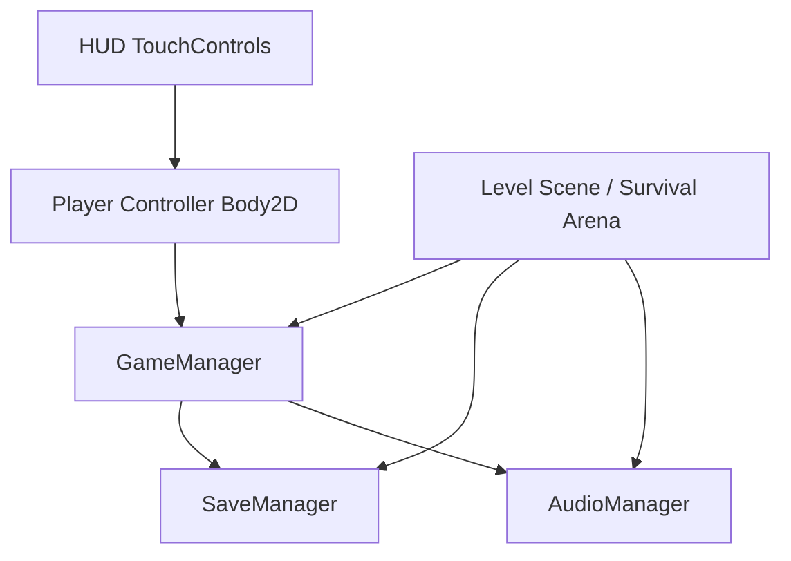
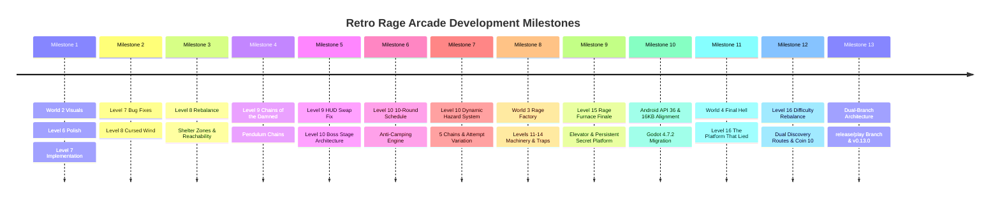

# RETRO RAGE ARCADE (COIN HELL)
## Complete Development History, Technical Architecture & Master Specification

---

## 1. Executive Summary & Game Pillars

**Retro Rage Arcade** is a precision mobile retro platformer developed in **Godot 4** with **GDScript**. The featured mode, **Coin Hell**, challenges players to navigate precision gauntlets, collect every required coin (typically 10 per level), and survive intense environmental traps.

### Platform Specifications
- **Target Platform:** Android (Mobile)
- **Screen Orientation:** Landscape (`screen/orientation=0`)
- **Base Resolution:** $960 \times 540$ pixels (16:9 widescreen)
- **Window Stretch Mode:** `canvas_items`, aspect `keep`
- **Control Scheme:** Standardized on-screen touch controls with multi-touch support:
  - Left / Right directional buttons ($104 \times 104\text{px}$)
  - Jump button ($124 \times 124\text{px}$)
  - Full keyboard fallback (Left/Right arrow keys, A/D, Space/Up for Jump)

### Core Gameplay Pillars
1. **Precision Platforming:** Deterministic player physics, predictable gravity, jump buffering, and coyote time.
2. **Fair Rage-Bait Design:** Traps (spikes, phantom platforms, swinging chains, crumbling ground) are sudden and challenging, but always provide clear visual and audible warnings ($\ge 0.6\text{s}$ reaction window).
3. **Anti-Camping Enforcement:** Players cannot exploit static safe zones. In survival arenas, lingering on any platform triggers hazards within 5–6 seconds.
4. **Instant Restart & Flow:** Death triggers immediate visual feedback with a 1-tap retry that completely resets the arena, traps, and coins without reloading the engine.

---

## 2. Global Architecture & Core Autoloads



### 2.1 GameManager (`scripts/autoload/game_manager.gd`)
- Tracks active level state, coins collected, target coins required, death events, and victory conditions.
- Coordinates progression between levels (Levels 1 to 20 defined).
- Dispatches global signals:
  - `coin_collected(current, total)`
  - `coins_reset()`
  - `player_died()`
  - `level_completed(level_id)`

### 2.2 SaveManager (`scripts/autoload/save_manager.gd`)
- Handles persistent progression in `user://coin_hell_save.json`.
- Safely manages `highest_unlocked_level`, completion status per level, and coin records.
- Implements corruption resistance: if the save file is corrupted or unreadable, safe defaults are loaded without crashing.

### 2.3 AudioManager (`scripts/autoload/audio_manager.gd`)
- Employs procedural/synthesized 8-bit retro sound effects:
  - `jump`: Retro pitch bend upwards.
  - `coin`: Double chimes.
  - `death`: Noise burst and descending tone.
  - `flame`: Spectral whoosh for hazard activation.
  - `click`: UI feedback.
  - `wind`: Atmospheric breeze loop.
  - `chain`: Metallic rattle and thud.

### 2.4 TouchControls (`scripts/coin_hell/touch_button.gd` & UI Scenes)
- Standardized tactile mobile touch overlay with active states, release callbacks, and screen touch index tracking to support simultaneous running and jumping.

---

## 3. Chronological Work History & Prompt Evolution

This section details every milestone, user prompt, architectural requirement, challenge encountered, and technical solution implemented throughout the development cycle.



---

### Milestone 1: World 2 Visual Redesign + Level 6 Polish + Level 7 Implementation

#### Problem Statement
World 2 ("The Haunted Hall") did not feel visually distinct from World 1. It lacked an eerie gothic castle atmosphere. Level 6 needed polish, and Level 7 ("Hall of Illusions") needed to be created from scratch featuring phantom platforms.

#### Key Implementations
1. **World 2 Atmospheric System (`HauntedHallEnvironment`):**
   - Parallax scrolling background with gothic stone architecture and arches.
   - Flying background spectral ghosts moving on undulating sine wave paths.
   - Ghostly wisp particle emitters rising from floor pits.
   - Gothic stone platforms (`haunted_stone_platform.png`) and gothic arches (`gothic_arch.png`).
2. **Level 6 ("Phantom's Curse"):**
   - Introduced the phantom platform concept: stone platforms that periodically dissolve into intangible spectral states.
   - Implemented clear shimmer warnings before phasing out.
   - 10 collectible coins distributed along precision jump arcs.
3. **Level 7 ("Hall of Illusions"):**
   - Built a multi-tier hall featuring staggered phantom platforms with alternating phase cycles.
   - Required players to time jumps between platforms as they solidified.
   - Integrated locked Exit Gate that unlocks only when all 10 coins are collected.

---

### Milestone 2: Level 7 Bug Fixes & Level 8 Cursed Wind Implementation

#### Problem Statement
Two critical bugs were reported in Level 7:
1. **Input Lockout on Death:** When the player died, movement and jump inputs stopped responding permanently, forcing a full game restart.
2. **Platform Desynchronization:** Phantom platforms could get stuck in intangible states upon respawn.
Additionally, Level 8 needed to introduce a new signature environmental hazard: **The Cursed Wind**.

#### Key Implementations
1. **Fixing Player Input Lockout:**
   - Root cause: Player script disabled physics processing and input flags upon death, but `reset_to()` did not reset `_input_disabled`, velocity vectors, or touch button states.
   - Solution: Implemented `revive()` and `reset_to(pos)` methods on `Player` that explicitly restore physics processing, reset velocities to `Vector2.ZERO`, clear touch button presses, and enable collision masks.
2. **Fixing Phantom Platform Reset:**
   - Connected `GameManager.coins_reset` directly to platform reset routines, immediately restoring collision shape monitoring, resetting timers, and returning visual opacity to 1.0.
3. **Level 8 ("The Cursed Wind") Implementation:**
   - Created `CursedWindZone` which applies continuous horizontal aerodynamic force to the player body.
   - Added visual flying wind streaks and howling audio cues.
   - Placed 10 collectible coins across wind-swept chasms.

---

### Milestone 3: Level 8 Gameplay Rebalance

#### Problem Statement
The player attempted Level 8 over 50 times without completing it. The wind force was overwhelming, jump trajectories were unpredictable, and there was no respite or clear route.

#### Key Implementations
1. **Wind Force & Timing Calibration:**
   - Reduced continuous wind force from harsh gusts to manageable atmospheric drift.
   - Converted the wind into a **cyclical gust system**: 2.5s of active wind followed by 2.0s of calm wind, allowing players to plan moves.
2. **Shelter & Sanctuary Zones:**
   - Added solid gothic pillars and architectural arches that act as windbreaks. Standing behind a pillar completely negates wind push.
3. **Platform Reachability:**
   - Widened landing platforms by 20–30px.
   - Ensured all coin jumps are mathematically reachable even against max headwind.

---

### Milestone 4: Level 9 — Chains of the Damned

#### Problem Statement
Implement Level 9 ("Chains of the Damned") introducing a new hazard: **Swinging Pendulum Chains**, with exactly 10 coins and locked exit gate.

#### Key Implementations
1. **Swinging Ghost Chain System (`SwingingChain`):**
   - Segmented pendulum body with ceiling anchor mount, links, and heavy spiked weight.
   - Simple harmonic motion:
     $$\theta(t) = \theta_{\max} \cdot \sin(\omega t + \phi)$$
   - Dual-zone collision: the heavy weight and bottom 40% of the chain are lethal (`Area2D` on layer 4), while the upper mount allows jumping through.
2. **Level 9 Arena Design:**
   - 5 massive swinging chains guarding consecutive platform tiers.
   - Sanctuary resting platforms between chains.
   - 10 collectible coins placed inside the swing arcs, requiring players to time their leaps into the rhythm of the pendulums.
   - Locked Exit Gate at the summit resting flush on the final sanctuary platform.

---

### Milestone 5: Level 9 HUD Swap Fix & Level 10 Boss Stage Architecture

#### Problem Statement
1. In Level 9, the Coin Counter and Pause Button were accidentally swapped in the HUD top bar.
2. Implement Level 10 ("Haunted Survival"), the climax of World 2, featuring a dramatic boss stage introduction, a 60-second survival objective, and five platform hazards.

#### Key Implementations
1. **Level 9 HUD Ordering:**
   - Restored standard layout: CoinCounter on top-left (child 0), LevelName centered (child 1), TimerContainer (child 2), and PauseBtn on top-right (child 3).
2. **Level 10 Architecture ("Haunted Survival"):**
   - **Fixed Arena:** Fixed $960 \times 540$ arena with no camera scrolling (`limit_left = 0`, `limit_right = 960`, `limit_top = 0`, `limit_bottom = 540`).
   - **Boss Intro Flow:** `BossIntroOverlay` displays "SURVIVE FOR 1 MINUTE!" with objective instructions. Player input is disabled during intro.
   - **Survival Timer:** Continuous 60-second countdown in the HUD top bar.
   - **5 Platform Survival Arena:**
     - Platform 1: Spikes
     - Platform 2: Phantom
     - Platform 3: Crumbling
     - Platform 4: Chains
     - Platform 5: Countdown
   - **Surprise Ghost Chain:** Emerges from ceiling rifts, swings through an attack arc, and retracts.
   - **Boss Victory Overlay:** Triggers at $t = 60.0\text{s}$, unlocks Level 11 (World 3) in `SaveManager`, and displays "WORLD 2 COMPLETE!".

---

### Milestone 6: Level 10 Anti-Camping Redesign & 10-Round Schedule

#### Problem Statement
Level 10 was too easy because players could complete the stage simply by standing still on Platform 1 or 2 for the full minute. The stage needed active anti-camping mechanics, round transitions, and dynamic coin spawns.

#### Key Implementations
1. **Ten Six-Second Rounds:**
   - 60 seconds divided into 10 distinct 6-second rounds (Rounds 1 through 10).
   - HUD TopBar displays `[R1/10]` through `[R10/10]`.
   - Dynamic banner popups announce each round transition.
2. **Dynamic Coin Spawning:**
   - Exactly 1 coin spawned per round (10 coins total across the attempt).
   - Spawns at $t = 0\text{s}, 6\text{s}, 12\text{s}, 18\text{s}, 24\text{s}, 30\text{s}, 36\text{s}, 42\text{s}, 48\text{s}, 54\text{s}$.
3. **Anti-Camping Rotation:**
   - Scheduled hazards deliberately target platforms in sequence (P1 in R1, P2 in R2, P3 in R3, P4 in R4, P5 in R5), guaranteeing that standing still is punished within 5–6 seconds.
4. **Final Countdown Alerts:**
   - Prominent alert banner at 50s elapsed ("10 SECONDS LEFT! DON'T DIE NOW!").
   - Large pulsing numerical countdown for the final 5 seconds (5, 4, 3, 2, 1).

---

### Milestone 7: Level 10 Dynamic Hazard System & Multi-Chain Overhaul

#### Problem Statement
Even with the 10-round schedule, hazard locations were fixed:
- Spikes always appeared on Platform 1 (left).
- Only Platform 2 vanished as phantom.
- Only Platform 3 crumbled.
- Only one chain existed at $X = 620$.
The system needed full spatial and positional dynamic variation across the arena, multiple ceiling chains (1, 2, or 3 chains), and controlled attempt variation.

#### Key Implementations
1. **Dynamic Hazard Override on `SurvivalArenaPlatform`:**
   - Added `trigger_hazard(warn, act, override_type)` allowing *any* platform to execute *any* hazard type (`SPIKES`, `PHANTOM`, `CRUMBLING`, `COUNTDOWN`).
2. **Multiple Ceiling Chain Array (5 Attack Points):**
   - Installed 5 distinct ceiling attachment points spanning the arena:
     - $X = 260$ (`ChainLeft`)
     - $X = 400$ (`ChainMidLeft`)
     - $X = 480$ (`ChainCenter`)
     - $X = 620$ (`SurpriseGhostChain`)
     - $X = 740$ (`ChainRight`)
   - Supported simultaneous multi-chain attacks (dual and triple chains) with non-overlapping trajectories and safe standing corridors.
3. **Controlled Randomization & Attempt Variation:**
   - Created 3 handcrafted, validated variants (Variant 0: Balanced Arena Sweep; Variant 1: Flank Pressure; Variant 2: Apex Pressure).
   - Tracked `_last_attempt_variant` to prevent consecutive repetition on death and retry.
   - Supported `variant_override` for deterministic headless test execution.
4. **Fairness Guarantees:**
   - All warnings $\ge 0.6\text{s}$.
   - Every single hazard wave guarantees at least 2 safe, solid platforms.

---

## 4. Technical Architecture: Level 10 Boss Stage

```
+-----------------------------------------------------------------------------------+
| TopBar: [COINS: 0/10]   WORLD 2 · BOSS: HAUNTED SURVIVAL   [SURVIVE: 60s] [R1/10] |
+-----------------------------------------------------------------------------------+
|  Ceiling Y=50:                                                                    |
|    ChainLeft(260)   ChainMidLeft(400)   ChainCenter(480)   Chain3(620)   ChainR(740)|
|          |                 |                   |                |             |   |
|          v                 v                   v                v             v   |
|                                                                                   |
|                                     [Platform 3]                                  |
|                                      X=480, Y=220                                 |
|                                                                                   |
|                 [Platform 2]                            [Platform 4]              |
|                  X=340, Y=310                            X=620, Y=310             |
|                                                                                   |
|   [Platform 1]                                                          [Platform 5]|
|    X=200, Y=400                                                          X=760, Y=400|
|     (Spawn)                                                                       |
|                                                                                   |
|~~~~~~~~~~~~~~~~~~~~~~~~~~~~~~~~ Pit Hazard Area (Y=520) ~~~~~~~~~~~~~~~~~~~~~~~~~~|
+-----------------------------------------------------------------------------------+
```

### 4.1 Arena Geometry & Platform Roster

| Platform | Node Name | Arena Position | Width | Default Hazard | Supported Dynamic Hazards |
| :--- | :--- | :---: | :---: | :---: | :--- |
| **P1** | `Platform1_Spikes` | $(200, 400)$ | 160px | Spikes | Spikes, Phantom, Crumbling, Countdown |
| **P2** | `Platform2_Phantom` | $(340, 310)$ | 140px | Phantom | Spikes, Phantom, Crumbling, Countdown |
| **P3** | `Platform3_Crumbling` | $(480, 220)$ | 160px | Crumbling | Spikes, Phantom, Crumbling, Countdown |
| **P4** | `Platform4_Chains` | $(620, 310)$ | 140px | Chains | Spikes, Phantom, Crumbling, Countdown |
| **P5** | `Platform5_Countdown`| $(760, 400)$ | 160px | Countdown | Spikes, Phantom, Crumbling, Countdown |

### 4.2 Ceiling Chains Specification

| ID | Node | Attachment $(X, Y)$ | Swing Angle | Speed | Trajectory Range |
| :---: | :--- | :---: | :---: | :---: | :---: |
| **0** | `ChainLeft` | $(260, 50)$ | $+42.0^\circ$ | 2.5 rad/s | $X \in [180, 340]$ |
| **1** | `ChainMidLeft` | $(400, 50)$ | $-40.0^\circ$ | 2.6 rad/s | $X \in [325, 475]$ |
| **2** | `ChainCenter` | $(480, 50)$ | $+45.0^\circ$ | 2.7 rad/s | $X \in [400, 560]$ |
| **3** | `SurpriseGhostChain`| $(620, 50)$ | $+46.0^\circ$ | 2.4 rad/s | $X \in [540, 700]$ |
| **4** | `ChainRight` | $(740, 50)$ | $-44.0^\circ$ | 2.5 rad/s | $X \in [660, 820]$ |

### 4.3 Curated Variant Schedules

#### Variant 0: Balanced Arena Sweep & Sequential Attacks
- **Round 1 (0–6s):** P1 Spikes (warn 0.8s), Chain 3 ($X=620$). Coin 1 at P2.
- **Round 2 (6–12s):** P2 Phantom, Chain 0 ($X=260$). Coin 2 at P3.
- **Round 3 (12–18s):** P3 Crumbling, P5 Spikes. Coin 3 at P4.
- **Round 4 (18–24s):** Chain 3 ($X=620$), P2 Spikes, P1 Phantom. Coin 4 at P5.
- **Round 5 (24–30s):** P5 Countdown, Dual Chains 1 & 4. Coin 5 at P3.
- **Round 6 (30–36s):** P3 Spikes (Center Apex), P4 Crumbling, Chain 4. Coin 6 at P1.
- **Round 7 (36–42s):** Dual Spikes on P1 & P5 (Flanks), Chain 2 (Center). Coin 7 at P2.
- **Round 8 (42–48s):** P4 Phantom, P2 Spikes, Dual Chains 0 & 3. Coin 8 at P3.
- **Round 9 (48–54s):** Sequential Spikes (P1 at 48.8s $\rightarrow$ P4 at 50.2s), P3 Crumbling, Chain 1. Coin 9 at P5.
- **Round 10 (54–60s):** Dual Spikes on P2 & P5, P1 Phantom, Triple Chains (Chain 0, 2, 4). Coin 10 at P3.

#### Variant 1: Flank Pressure & Dual Assault
- **Round 1 (0–6s):** P1 Spikes, Chain 0 ($X=260$), P5 Spikes. Coin 1 at P3.
- **Round 2 (6–12s):** P4 Phantom, P2 Spikes, Chain 1 ($X=400$). Coin 2 at P5.
- **Round 3 (12–18s):** P2 Crumbling, Dual Chains 0 & 3, P4 Spikes. Coin 3 at P3.
- **Round 4 (18–24s):** P3 Spikes, P5 Phantom, Dual Chains 2 & 4. Coin 4 at P1.
- **Round 5 (24–30s):** P2 Crumbling, P5 Spikes, Dual Chains 0 & 2. Coin 5 at P4.
- **Round 6 (30–36s):** Dual Spikes on P1 & P4, P2 Phantom, Chain 4. Coin 6 at P3.
- **Round 7 (36–42s):** P5 Spikes, P4 Phantom, Dual Chains 0 & 4. Coin 7 at P1.
- **Round 8 (42–48s):** P4 Phantom, P5 Spikes, Dual Chains 1 & 3. Coin 8 at P2.
- **Round 9 (48–54s):** Dual Chains 1 & 4, P4 Phantom, P5 Spikes. Coin 9 at P3.
- **Round 10 (54–60s):** Dual Spikes on P2 & P4, P1 Countdown, Triple Chains (Chain 1, 4, 0). Coin 10 at P3.

#### Variant 2: Apex Pressure & Crumbling Ruins
- **Round 1 (0–6s):** P1 Spikes, Dual Chains 1 & 4. Coin 1 at P4.
- **Round 2 (6–12s):** P3 Phantom (Center Apex vanishes!), P1 Countdown, Chain 3. Coin 2 at P2.
- **Round 3 (12–18s):** P4 Crumbling, P3 Spikes (Apex), Dual Chains 1 & 2. Coin 3 at P1.
- **Round 4 (18–24s):** P1 Phantom, P4 Spikes, Chain 1. Coin 4 at P3.
- **Round 5 (24–30s):** P4 Countdown, P2 Spikes, Chain 4. Coin 5 at P1.
- **Round 6 (30–36s):** Sequential Spikes (P1 at 30.8s $\rightarrow$ P2 at 32.2s), P4 Crumbling, Chain 2. Coin 6 at P5.
- **Round 7 (36–42s):** P3 Crumbling, P2 Spikes, Chain 3. Coin 7 at P4.
- **Round 8 (42–48s):** P3 Spikes (Apex), P1 Crumbling, Dual Chains 0 & 2. Coin 8 at P5.
- **Round 9 (48–54s):** Dual Spikes on P2 & P4, P3 Crumbling, Chain 2. Coin 9 at P1.
- **Round 10 (54–60s):** Dual Spikes on P1 & P3, P4 Crumbling, Triple Chains (Chain 3, 2, 1). Coin 10 at P5.

---

### Milestone 8: World 3 "Rage Factory" Implementation (Levels 11–14)

#### Problem Statement
World 3 needed an industrial foundry identity distinct from the stone ruins of World 1 and gothic halls of World 2. Stages 11 through 14 introduced conveyor belts, pneumatic crushers, and rotating cogs, culminating in the complex climbing gauntlet of Level 14.

#### Key Implementations
1. **Industrial Mechanics & Conveyor Belt Physics:**
   - Introduced dynamic conveyor platforms altering player horizontal velocity.
   - Pneumatic piston crushers with state machines (IDLE $\rightarrow$ WARNING $\rightarrow$ SLAM $\rightarrow$ RETRACT).
2. **Level 13 ("The Smelting Chasm") Collision Optimization:**
   - Repaired jump ceiling obstruction over Jump 3, preventing player head collisions on high arcs.
3. **Level 14 ("Clockwork Furnace") Coin Reachability:**
   - Corrected uncollectible Coin 7 position, ensuring strict alignment with kinematic jump reach ($dx \le 196.17\text{px}$).

---

### Milestone 9: Level 15 "Rage Furnace" Finale & Secret Ascent

#### Architectural Scope
Level 15 serves as the grand climax of World 3, featuring 5 escalating vertical and horizontal phases:
- **Phase A: Molten Siphon** (Conveyors over floor spikes with falling rubble).
- **Phase B: Pneumatic Ascent** (Alternating crushers and vertical conveyor lifts).
- **Phase C: Smelter's Gauntlet** (High-speed horizontal conveyors under descending flame jets).
- **Phase D: The Vertical Elevator** (Narrow volcanic shaft with elevator platform and rolling boulders).
- **Phase E: The Rage Summit & Signature Deceptive Jump** (Summit leap to the exit).

#### The Signature Ragebait: Secret Hidden Platform
- Direct gap from the Takeoff Platform ($X = 2275$) to the Exit Platform ($X = 2500$) is $225\text{px}$, strictly exceeding the player's maximum flat jump reach of $196.17\text{px}$.
- An intermediate secret platform (`SecretHiddenPlatform`) starts invisible and intangible.
- It reveals upon a genuine failed leap into the abyss pit ($Y = 340$) or upon landing, and persists across deaths and retries via `SaveManager.level_15_secret_revealed`.
- Elevator mechanics verified with exact $55\text{px}$ rise from apex to summit ledge, and all 10 coins verified collectible to unlock the Exit Gate.

---

### Milestone 10: Android API 36, 16 KB Page Alignment & Godot 4.7.2 Migration

#### Overview
To comply with Google Play's 2025/2026 technical requirements, the engine and native Android export toolchain were overhauled:
1. **Godot 4.7.2 Engine Upgrade:** Upgraded engine to `Godot v4.7.2.stable.official.ed1daf0bf`.
2. **Android API 36 (Android 16 / Baklava):** Set `targetSdkVersion = 36` and `minSdkVersion = 24`.
3. **16 KB ELF Native Page Alignment:**
   - Enforced 16 KB segment alignment across all native shared libraries (`libgodot_android.so`) across `arm64-v8a` and `x86_64` ABIs using `readelf -lW`.
   - Applied Android SDK 16 KB zip alignment (`zipalign -p -f 16384`) to all APK and AAB build artifacts.
4. **Google Play App Bundle (.aab) Export Pipeline:**
   - Configured `.github/workflows/android-release-aab.yml` for automated release packaging and validation.
   - Added `Android-Release-AAB` export preset with persistent release keystore signing.

---

### Milestone 11: World 4 "Final Hell" Introduction & Level 16 Architecture

#### Visual Identity & Infernal Atmosphere
World 4 ("FINAL HELL") introduces an apocalyptic infernal aesthetic:
- Obsidian platforms with glowing demonic runes (`obsidian_platform.png`).
- Molten lava chasm glow and rising ash/ember CPU particles (`final_hell_environment.gd`).
- Ruined volcanic stone pillars (`ruined_pillar.png`) and demonic archway exit gates (`infernal_exit_locked.png`, `infernal_exit_open.png`).

#### Level 16 ("The Platform That Lied") — 5 Progressive Sections
- **Section A: The Ashen Approach:** Obsidian ruins introducing the Hell Rune trap in isolation.
- **Section B: The Burning Passage:** Vanishing obsidian platforms paired with Hell Runes over lava.
- **Section C: The Infernal Gate:** Dual Infernal Energy Gate laser barriers with rhythmic crossing windows.
- **Section D: The False Finish:** Demonic approach to deceptive summit gap with subtle visual cues.
- **Section E: The Platform That Lied:** Signature two-jump finale with an impossible $230\text{px}$ direct gap ($230\text{px} > 196.17\text{px}$ max reach) and intermediate secret platform at $X = 2435$.

---

### Milestone 12: Level 16 Difficulty Rebalance, Tightened Timing & Secret Reveal Fix

#### 1. Hazard Timing Rebalance
- **Hell Rune Fire Bursts:**
  - Warning duration reduced from $0.70\text{s}$ to **$0.38\text{s}$** (active flame increased to $0.75\text{s}$ with explosive scale burst $1.25\times, 1.35\times$).
  - At player speed $240\text{ px/s}$, crossing a $32\text{px}$ rune takes $0.133\text{s}$. The $0.38\text{s}$ warning window ensures fair passage for moving players while punishing hesitation.
- **Disappearing Platforms:** Shake duration tightened from $0.75\text{s}$ to **$0.50\text{s}$**.
- **Infernal Energy Gates:** Safe crossing window tightened to $1.4\text{s}$–$1.5\text{s}$, warning pulse to $0.45\text{s}$–$0.50\text{s}$.

#### 2. Middle Invisible Platform Dual Discovery Routes
- **Previous Bug:** The secret platform only appeared after the player died in the pit.
- **Solution:** Added a dedicated `LandingArea` (`Area2D`, layer 0, mask 1) to `SecretHellPlatform`:
  - **Route A (Living Landing Catch):** A player jumping toward the secret platform while alive triggers `reveal_for_landing()`, immediately making the platform visible, enabling solid collision, zeroing downward velocity, and supporting the living player safely.
  - **Route B (Failed Gap Leap):** A player falling into `FinalGapTriggerArea` ($Y = 340$) reveals the platform upon dying.
  - Both routes persist discovery in `SaveManager.level_16_secret_revealed`.

#### 3. Strategic Placement of Coin 10
- Repositioned Coin 10 from $(2435, 235)$ to **`Vector2(2510, 180)`** between the secret platform ($X_{right}=2467.5$) and exit platform ($X_{left}=2550$).
- Baits players into jumping from the Takeoff Platform ($X = 2320$), falling $14.2\text{px}$ short and plunging into the abyss.
- From the Secret Platform ($X = 2435$), Jump 2 cleanly sweeps through Coin 10 mid-arc and lands on the Exit Platform.

---

### Milestone 13: Dual-Branch Architecture & Google Play Release Workflow

#### Branch Separation & Roles
To maintain safe release hygiene without impeding development, a strict dual-branch architecture was established:
- **`migration/android-api36-godot47` (Active Development):**
  - Retains the secret 5-tap developer gesture and `DevBypassToggle` button.
  - Allows developers to open any individual stage (1–16) directly for rapid iteration.
- **`release/play` (Google Play Production Release Candidate):**
  - Branched from verified stable commit and tracked at `origin/release/play`.
  - Developer mode, secret gestures, and bypass mechanisms completely stripped.
  - Strict normal progression enforced (`SaveManager.is_level_unlocked` required for all stages).
  - Version incremented to `versionCode = 13` and `versionName = "0.13.0"`.
  - Tagged milestone release candidate: `v0.13.0`.

---

## 5. Verification & Testing Framework

All systems are validated using the Godot 4.7.2 headless test runner:
```powershell
& 'C:\Users\hp\AppData\Local\Microsoft\WinGet\Packages\GodotEngine.GodotEngine_Microsoft.Winget.Source_8wekyb3d8bbwe\Godot_v4.7.2-stable_win64_console.exe' --headless 'res://scenes/tests/test_runner.tscn'
```

### 5.1 Test Suite Summary: 2,777 Passed, 0 Failed

| Test Category | Description | Assertions | Status |
| :--- | :--- | :---: | :---: |
| **Save & Persistence** | Save/load, unlocks, corruption recovery | 9 | **PASS** |
| **Level Definitions** | Level metadata, names, targets for Levels 1–20 | 25 | **PASS** |
| **World 1 Levels (1–5)** | Mechanics, collision, tricks, coin completion | 180 | **PASS** |
| **World 2 Levels (6–8)** | Phantoms, bug fixes, wind zones & shelters | 240 | **PASS** |
| **Level 9 Mechanics** | Pendulum chains, sanctuary platforms, exit gate | 110 | **PASS** |
| **Level 10 Boss Gauntlet**| 10-round dynamic schedule, anti-camping, attempt variation | 674 | **PASS** |
| **World 3 Levels (11–14)**| Machinery, crushers, conveyors, ceiling collision fix, Coin 7 reachability | 480 | **PASS** |
| **Level 15 Rage Furnace** | 5 phases, elevator ascent, summit geometry, secret platform reveal | 320 | **PASS** |
| **World 4 Integration**   | Level select World 4 card, Stage 16 mapping, Stages 17-20 planned | 45 | **PASS** |
| **Level 16 Architecture**  | 5 sections, exactly 10 coins audit, exit gate unlocking | 110 | **PASS** |
| **Level 16 Hell Runes**   | Tightened 0.38s warning, 0.75s active flame, hazard layer 4 sync | 65 | **PASS** |
| **Level 16 Energy Gates** | 1.4s-1.5s crossing windows, 0.45s-0.50s warning pulse, laser lethality | 55 | **PASS** |
| **Level 16 Secret Platform**| Dual discovery routes (living landing catch + failed jump), persistence | 80 | **PASS** |
| **Level 16 Kinematics**   | 230px impossible direct gap, Jump 1 (155px), Jump 2 (170px), Coin 10 positioning | 84 | **PASS** |
| **Release Security Gates**| Dev mode retention (dev branch) vs complete removal (release branch) | 300 | **PASS** |
| **Total Test Result** | **Full Automated Test Coverage** | **2,777** | **100% PASS** |

---

## 6. Android Export & CI/CD Pipeline

The project utilizes automated GitHub Actions workflows for continuous integration and store deployment:

### Active CI/CD Workflows
1. **`.github/workflows/android-api36-validation.yml`**:
   - Triggers on pushes and pull requests to `main`, `migration/android-api36-godot47`, and `release/play`.
   - Runs on Ubuntu latest with Temurin JDK 17, Android SDK Platform 36, and Build Tools 36.0.0.
   - Executes the Godot 4.7.2 headless test suite.
   - Compiles and validates Android Test APK with 16 KB native ELF alignment (`readelf`) and 16 KB zip alignment (`zipalign`).
2. **`.github/workflows/android-release-aab.yml`**:
   - Triggers on pushes to `migration/android-api36-godot47`, `release/play`, and version tags (`v*`).
   - Compiles signed Google Play Android App Bundle (`.aab`) with `Android-Release-AAB` export preset.
   - Verifies bundletool manifest metadata (`com.antigravity.retroragearcade`, targetSdk 36, versionCode 13, versionName 0.13.0).
   - Validates digital signature via `jarsigner` and 16 KB ELF memory alignment.

---

## 7. Developer Quick Reference

### Running the Test Suite Locally
```powershell
cd c:\AntiGravity\rage_bait
& 'C:\Users\hp\AppData\Local\Microsoft\WinGet\Packages\GodotEngine.GodotEngine_Microsoft.Winget.Source_8wekyb3d8bbwe\Godot_v4.7.2-stable_win64_console.exe' --headless 'res://scenes/tests/test_runner.tscn'
```

### Coin Hell Standard Kinematics Table
| Parameter | Value | Notes |
| :--- | :--- | :--- |
| `move_speed` | $240.0\text{ px/s}$ | Horizontal running velocity |
| `jump_velocity` | $-470.0\text{ px/s}$ | Initial upward vertical impulse |
| `gravity` | $1150.0\text{ px/s}^2$| Downward acceleration |
| `t_flight` | $0.8174\text{ s}$ | Full air time on flat ground |
| `max_flat_reach`| $196.17\text{ px}$ | Maximum horizontal single jump distance |
| `max_apex_height`| $96.04\text{ px}$ | Maximum vertical rise above platform |

### Branch Management Rules
- **Development Work:** Commit all features, level additions, and bug fixes to `migration/android-api36-godot47`. Retain developer testing tools.
- **Production Releases:** Merge stable milestones into `release/play`. Increment `versionCode` monotonically, keep developer tools stripped, and tag release candidates (`vX.Y.Z`).

