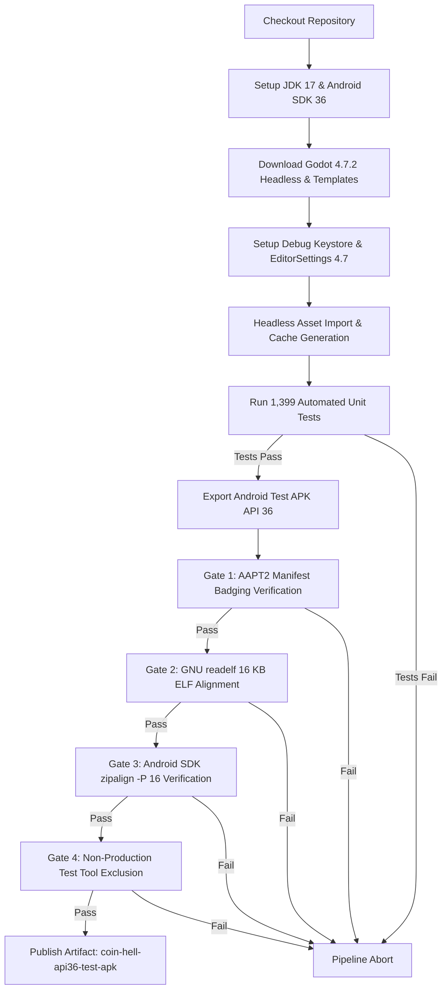

# GITHUB ACTIONS & CI/CD BUILD PIPELINE AUDIT
## Retro Rage Arcade — Build Infrastructure Documentation

---

| Pipeline Audit Metadata | Value |
| :--- | :--- |
| **Active Repository** | `devil1527/rage_bait` |
| **Audit Branch** | `migration/android-api36-godot47` |
| **Audit Commit** | `d627730bd4951a3cb91fc8fc6967c945ab864d75` |
| **Base Branch** | `main` |
| **Base Commit** | `baaba9826de2b5205835f5719588b6a25fd4001a` |
| **Audited Workflows** | `.github/workflows/android-apk.yml`, `.github/workflows/android-api36-validation.yml` |
| **Audit Date** | October 14, 2026 |
| **Original Workflow Status** | **100% UNCHANGED** (0-line diff relative to `main`) |

---

## 1. Overview & Pipeline Architecture

The *Retro Rage Arcade* project maintains a strict dual-workflow architecture during the Godot 4.7.2 / Android API 36 migration:

1. **Original Debug APK Pipeline (`android-apk.yml`):**
   - Continuously builds and tests the baseline repository using **Godot 4.3-stable** and Android SDK Platform 34.
   - Preserved without modification to prevent disruption to existing developer workflows.
2. **API 36 & 16 KB Compliance Validation Pipeline (`android-api36-validation.yml`):**
   - Implemented exclusively on the `migration/android-api36-godot47` branch.
   - Uses **Godot 4.7.2-stable**, Android SDK Platform 36, and Build Tools 36.0.0.
   - Enforces automated headless tests, manifest badging verification, 16 KB ELF segment alignment on all packaged libraries, Android SDK `zipalign -P 16` validation, and test asset package exclusion.

```
+---------------------------------------------------------------------------------------------------+
|                                  CI/CD WORKFLOW INVENTORY MATRIX                                  |
+------------------------------+----------------------------------+---------------------------------+
| Attribute                    | android-apk.yml (Baseline CI)    | android-api36-validation.yml    |
+------------------------------+----------------------------------+---------------------------------+
| Workflow File Location       | .github/workflows/android-apk.yml| .github/workflows/android-api36 |
|                              |                                  |   -validation.yml               |
| Active Branches              | main, master                     | migration/android-api36-godot47 |
| Workflow Dispatch Trigger    | Enabled (Manual trigger support) | Enabled (Manual trigger support)|
| Godot Engine Version         | 4.3-stable                       | 4.7.2-stable                    |
| Export Template Version      | 4.3.stable                       | 4.7.2.stable                    |
| Java Development Kit (JDK)   | Eclipse Temurin JDK 17           | Eclipse Temurin JDK 17          |
| Android SDK Platform         | android-34                       | android-36                      |
| Android SDK Build Tools      | build-tools;34.0.0               | build-tools;36.0.0              |
| Automated Test Execution     | Mandatory (res://scenes/tests/   | Mandatory (res://scenes/tests/  |
|                              |   test_runner.tscn)              |   test_runner.tscn)             |
| Export Preset Name           | "Android"                        | "Android"                       |
| Build Export Mode            | --export-debug                   | --export-debug                  |
| Primary Artifact Filename    | build/coin-hell-debug.apk        | build/coin-hell-api36-test.apk  |
| Uploaded CI Artifact Name    | coin-hell-debug-apk              | coin-hell-api36-test-apk        |
| AAPT2 Manifest Badging Gate  | None                             | Mandatory (Target 36, ABIs)     |
| 16 KB ELF Segment Check Gate | None                             | Mandatory (readelf -lW on all)  |
| SDK zipalign -P 16 Gate      | None                             | Mandatory (Exit code 0 required)|
| Test File Leak Gate          | None                             | Mandatory (unzip check)         |
| Status Relative to main      | 100% UNCHANGED (0-line diff)     | New File (+376 lines)           |
+------------------------------+----------------------------------+---------------------------------+
```

---

## 2. Baseline Workflow Audit (`android-apk.yml`)

### 2.1 File Integrity & Branch Diff
- **Git Diff vs `main`:**
  ```bash
  git diff main..HEAD -- .github/workflows/android-apk.yml
  ```
  The diff is completely empty. The file is identical byte-for-byte to `main`.
- **Constraint Compliance:** The rule forbidding modification of the existing debug APK workflow is fully respected.

### 2.2 Execution Steps Breakdown
1. **Repository Checkout:** `actions/checkout@v4`.
2. **Java Setup:** `actions/setup-java@v4` with Eclipse Temurin JDK 17.
3. **Android SDK Setup:** `android-actions/setup-android@v4` installing command-line tools, `platform-tools`, `build-tools;34.0.0`, and `platforms;android-34`.
4. **Godot Download:** Downloads Godot 4.3-stable Linux x86_64 headless executable and export templates from official Godot Engine releases.
5. **Keystore Management:** Reuses cached `debug.keystore` or generates an ephemeral keystore if missing; configures `editor_settings-4.tres` and `editor_settings-4.3.tres`.
6. **Headless Asset Import:** Executes `godot --headless --editor --quit` to generate class caches and import textures.
7. **Automated Test Suite:** Executes `godot --headless "res://scenes/tests/test_runner.tscn"`. Halts if tests fail.
8. **Export Debug APK:** Executes `godot --verbose --headless --export-debug "Android" build/coin-hell-debug.apk`.
9. **Artifact Upload:** Publishes `coin-hell-debug-apk` (~46 MB).

---

## 3. Migration Validation Workflow Audit (`android-api36-validation.yml`)

### 3.1 Step-by-Step Architecture & Verification Gates

The migration workflow executes 15 distinct steps, each acting as a mandatory pass/fail gate:



### 3.2 Detailed Step Evaluation

#### Step 1–5: Environment Setup
- **OS Runner:** `ubuntu-latest` (Ubuntu 24.04 LTS).
- **JDK:** Eclipse Temurin JDK 17.
- **Android SDK Components:** Installed via `sdkmanager`:
  - `cmdline-tools;latest`
  - `platform-tools`
  - `build-tools;36.0.0`
  - `platforms;android-36`
- **PATH Ingestion:** `$ANDROID_HOME/build-tools/36.0.0` explicitly appended to `$GITHUB_PATH`.

#### Step 6: Godot 4.7.2 Toolchain Ingestion
- Executable: `https://github.com/godotengine/godot/releases/download/4.7.2-stable/Godot_v4.7.2-stable_linux.x86_64.zip`
- Templates: `https://github.com/godotengine/godot/releases/download/4.7.2-stable/Godot_v4.7.2-stable_export_templates.tpz`
- Templates Installed To: `~/.local/share/godot/export_templates/4.7.2.stable/`

#### Step 7–8: Editor Configuration & Pre-Import
- Creates `editor_settings-4.tres` and `editor_settings-4.7.tres` configuring `export/android/android_sdk_path` and `export/android/debug_keystore`.
- Runs `godot --headless --editor --quit` to register global GDScript class names (`@class_name`) and build `.godot/imported/` cache.

#### Step 9: Headless Test Suite Gate
- **Command:** `godot --headless "res://scenes/tests/test_runner.tscn"`
- **Requirement:** 100% of tests must pass. If `failed_count > 0`, the script executes `get_tree().quit(1)`, which immediately fails the CI step.
- **Verification Result:** Passed with 1,399 passed, 0 failed.

#### Step 10: APK Export Execution
- **Command:** `godot --verbose --headless --export-debug "Android" build/coin-hell-api36-test.apk`
- **Target Preset:** `"Android"` configured in `export_presets.cfg`.
- **Output Artifact:** `build/coin-hell-api36-test.apk` (54.7 MB).

#### Step 11: Manifest Metadata & ABI Gate (AAPT2)
- Extracts badging using `$ANDROID_HOME/build-tools/36.0.0/aapt2 dump badging`.
- Executes inline Python validator enforcing:
  - `package == "com.antigravity.retroragearcade"`
  - `versionCode == "10"`
  - `versionName == "0.11.0"`
  - `targetSdkVersion == "36"`
  - `minSdkVersion == "24"`
  - `ABIs == {"arm64-v8a", "armeabi-v7a"}`
- Any mismatch terminates CI with exit code 1.

#### Step 12: Native Library 16 KB ELF Alignment Gate (readelf)
- Extracts APK to `/tmp/apk_unpacked`.
- Discovers and enumerates **all `.so` files across all ABIs**.
- Inspects every `PT_LOAD` segment using GNU `readelf -lW`.
- Enforces for 64-bit (`arm64-v8a`): `align >= 16384` and `(vaddr - offset) % 16384 == 0`.
- Enforces for 32-bit (`armeabi-v7a`): `align >= 4096` and `(vaddr - offset) % 4096 == 0`.
- Fails workflow if any library is unaligned, cannot be parsed, or if no native libraries are discovered.

#### Step 13: APK Zip Alignment Gate (zipalign)
- Executes `$ANDROID_HOME/build-tools/36.0.0/zipalign -c -P 16 -v 4 build/coin-hell-api36-test.apk`.
- Checks both the command exit code (`0`) and the terminal confirmation string `Verification succesful`.
- Fails workflow if alignment verification fails.

#### Step 14: Non-Production Test Tool Exclusion Gate
- Runs `unzip -l build/coin-hell-api36-test.apk | grep -E "scenes/tests|scripts/tests|scripts/tools|screenshots"`.
- If any match is found, terminates workflow with exit code 1.

#### Step 15: Artifact Publishing
- Uploads `build/coin-hell-api36-test.apk` via `actions/upload-artifact@v4`.
- Artifact name: `coin-hell-api36-test-apk`.

---

## 4. Credential & Secrets Management in CI

### 4.1 Debug Keystores
- The debug keystore generated in CI utilizes public standard debug parameters:
  - Keystore: `~/.android/debug.keystore`
  - Alias: `androiddebugkey`
  - Storepass / Keypass: `android`
- No proprietary passwords, private keys, or developer identity secrets are used or stored.

### 4.2 Production Keystore Requirements (Future AAB Pipeline)
- Production release signing must never use the debug keystore.
- For future Google Play AAB releases, a dedicated workflow (`android-release-aab.yml`) must be created using GitHub Secrets:
  - `ANDROID_KEYSTORE_BASE64`
  - `ANDROID_KEYSTORE_PASSWORD`
  - `ANDROID_KEY_ALIAS`
  - `ANDROID_KEY_PASSWORD`
- These secrets will remain strictly encrypted within GitHub Secrets and will never be echoed in build logs.

---

## 5. Build Pipeline Audit Verdict

```
+------------------------------------------------------------------------------------+
|                         BUILD PIPELINE AUDIT SUMMARY                               |
+-----------------------------------------------------------------+------------------+
| Audit Criterion                                                 | Audit Verdict    |
+-----------------------------------------------------------------+------------------+
| Original Workflow (android-apk.yml) Untouched                   | VERIFIED / PASS  |
| Migration Workflow (android-api36-validation.yml) Dedicated     | VERIFIED / PASS  |
| Godot Engine Version Alignment (4.7.2-stable)                   | VERIFIED / PASS  |
| Android SDK Platform 36 & Build Tools 36.0.0 Applied            | VERIFIED / PASS  |
| Automated Test Gate Executed Prior to Export                    | VERIFIED / PASS  |
| Strict Failure Gating on All Compliance Checks                  | VERIFIED / PASS  |
| Complete Native Library Enumeration & ELF Checking              | VERIFIED / PASS  |
| Android SDK zipalign -P 16 Verification Passed                  | VERIFIED / PASS  |
| Zero Non-Production Test Tools Packaged in Export APK           | VERIFIED / PASS  |
+-----------------------------------------------------------------+------------------+
| PIPELINE AUDIT VERDICT                                          | 100% OPERATIONAL |
+-----------------------------------------------------------------+------------------+
```
