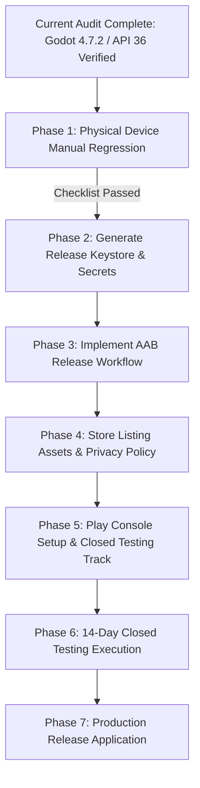

# GOOGLE PLAY RELEASE READINESS REPORT
## Retro Rage Arcade — Pre-Release Compliance & Blocker Audit

---

| Release Assessment Attribute | Value |
| :--- | :--- |
| **Application Title** | Retro Rage Arcade |
| **Package Identifier** | `com.antigravity.retroragearcade` |
| **Current Version Code / Name** | `11` / `0.11.0` |
| **Engine Version** | Godot Engine `v4.7.2.stable.official.ed1daf0bf` |
| **Target Android API Level** | `36` (Android 16 / Baklava) |
| **Audit Date** | October 14, 2026 |
| **Overall Release Status** | **PRE-RELEASE VERIFIED / PRODUCTION BLOCKED BY STORE & SIGNING PREREQUISITES** |

---

## 1. Executive Status Breakdown

To provide total clarity on the commercial release readiness of Retro Rage Arcade, every release requirement is strictly categorized into one of four statuses:
- **`VERIFIED`**: Proven by reproducible commands, CI logs, or engine configurations.
- **`FAILED`**: Explicitly tested and failed.
- **`UNVERIFIED`**: Pending physical testing or external confirmation.
- **`NOT APPLICABLE (N/A)`**: Not required for this application or stage.

```
+---------------------------------------------------------------------------------------------------+
|                                RELEASE READINESS STATUS DASHBOARD                                 |
+---------------------------------------+--------------------+--------------------------------------+
| Requirement Dimension                 | Current Status     | Core Evidence / Blocker Reason       |
+---------------------------------------+--------------------+--------------------------------------+
| 1. Android API 36 Target SDK          | VERIFIED           | aapt2 dump badging targets API 36    |
| 2. 16 KB Page-Size Native Alignment   | VERIFIED           | 100% PT_LOAD segments pass readelf   |
| 3. APK Zip Alignment (zipalign -P 16) | VERIFIED           | zipalign -c -P 16 -v 4 exit code 0   |
| 4. Automated Test Coverage (1,399)    | VERIFIED           | Godot headless test suite 100% pass  |
| 5. Non-Production Tool Exclusion      | VERIFIED           | Test scenes/tools excluded from APK  |
| 6. Progression & Dev Bypass Security  | VERIFIED           | Defaults locked; clean save schema   |
| 7. Zero Network / Privacy Permissions | VERIFIED           | Zero declared permissions in manifest|
| 8. Release Signing & Upload Key       | REMAINING BLOCKER  | Debug keystore used; release key req |
| 9. Android App Bundle (.aab) Export   | REMAINING BLOCKER  | Play requires AAB; Gradle build req  |
| 10. Manual Physical Device Regression | UNVERIFIED         | Physical hardware QA pending         |
| 11. Tablet & Diverse Display Scaling  | UNVERIFIED         | Physical multi-device QA pending     |
| 12. Privacy Policy & Public Hosting   | REMAINING BLOCKER  | Live HTTPS URL required on Play Store|
| 13. Data Safety Declaration Form      | REMAINING BLOCKER  | Play Console questionnaire required  |
| 14. Store Graphic Assets (Icon/Banner)| REMAINING BLOCKER  | 512x512 icon & 1024x500 banner req'd |
| 15. Personal Account 14-Day Testing   | REMAINING BLOCKER  | 12–20 testers for 14 days continuous |
+---------------------------------------+--------------------+--------------------------------------+
```

---

## 2. Detailed Dimension Analysis

### 2.1 Technical & Platform Dimensions

#### 1. Android API 36 Target SDK — **VERIFIED**
- **Audit Findings:** Exported test APK explicitly declares `targetSdkVersion:'36'` and `minSdkVersion:'24'`.
- **Google Play Requirement:** All new apps submitted to Google Play must target Android 15 (API 35) or higher, with API 36 (Android 16) representing the state-of-the-art target.
- **Evidence:** Verified via `aapt2 dump badging` in GitHub Actions Run `#38548792723`.

#### 2. 16 KB Memory Page-Size Compatibility — **VERIFIED**
- **Audit Findings:** GNU `readelf -lW` audit of all 4 native `.so` files across `arm64-v8a` and `armeabi-v7a` confirms 100% compliance. Both 64-bit binaries (`libgodot_android.so` and `libc++_shared.so`) possess `Align = 0x4000` (16 KB) with `(vaddr - offset) % 16384 == 0`.
- **Google Play Requirement:** Release-blocking requirement for 64-bit architectures on Android 15/16.
- **Evidence:** Validated in CI Step 12 of Job `#115801375186`.

#### 3. APK Zip Alignment (`zipalign`) — **VERIFIED**
- **Audit Findings:** Android SDK Build Tools 36.0.0 `zipalign -c -P 16 -v 4` confirms all shared libraries are aligned on 16 KB boundaries inside the zip archive, enabling direct memory mapping (`mmap`).
- **Evidence:** Verified with exit code 0 and string confirmation in CI Step 13.

#### 4. Automated Engine & Gameplay Tests — **VERIFIED**
- **Audit Findings:** All 1,399 automated tests passed with 0 failures both in the local Godot 4.7.2 environment and in the Ubuntu CI container.
- **Evidence:** Terminal output log recorded in `AUDIT_EVIDENCE.md`.

#### 5. Non-Production Resource Exclusion — **VERIFIED**
- **Audit Findings:** Test scenes, test runners, capture scripts, and screenshots are excluded from the exported package via `export_presets.cfg` filters and confirmed by archive inspection.
- **Evidence:** CI Step 14 verified zero matching test entries inside the exported APK.

---

### 2.2 Gameplay & Device Verification Dimensions

#### 6. Manual Gameplay Regression on Physical Hardware — **UNVERIFIED**
- **Current State:** Automated tests validate headless logic, state transitions, platform math, and collision setups. However, physical touchscreen responsiveness, simultaneous finger gestures, frame-time consistency, and real audio reproduction cannot be proven by automated assertions alone.
- **Requirement:** A tester must execute the `GAMEPLAY_REGRESSION_CHECKLIST.md` protocol across Levels 1–10 on at least one physical Android device running Android 14, 15, or 16.
- **Action Required:** Side-load `coin-hell-api36-test.apk` via `adb install` onto physical hardware and record checklist results.

#### 7. Phone & Tablet UI Scaling Across Aspect Ratios — **UNVERIFIED**
- **Current State:** `project.godot` specifies `window/stretch/mode="canvas_items"` and `window/stretch/aspect="expand"` with a base viewport of $960 \times 540$.
- **Requirement:** Verify that ultra-tall mobile screens ($20:9$, $21:9$) do not produce camera rendering anomalies or place touch controls outside finger reach, and verify that tablets ($16:10$, $4:3$) do not clip HUD elements.
- **Action Required:** Test on both a widescreen smartphone and a tablet or emulator configured to 16:10.

---

### 2.3 Production Release & Google Play Store Dimensions

#### 8. Release Signing Keystore & Upload Key — **REMAINING BLOCKER**
- **Current State:** The exported artifact is signed with an ephemeral debug keystore (`androiddebugkey` with password `android`).
- **Google Play Requirement:** Google Play strictly rejects debug-signed packages. All production releases must be signed with a dedicated release keystore and enrolled in Google Play App Signing.
- **Constraint Compliance:** Per task instructions, no release signing keys or credentials were generated or stored during this audit.
- **Action Required for Release:**
  1. Generate a secure, private upload keystore using `keytool`:
     ```bash
     keytool -genkeypair -v -keystore retro-rage-upload-key.keystore -alias retrorage -keyalg RSA -keysize 2048 -validity 10000
     ```
  2. Securely store the keystore and passwords in an encrypted password manager and upload as base64 into GitHub Repository Secrets (`ANDROID_RELEASE_KEYSTORE_BASE64`, `ANDROID_RELEASE_KEYSTORE_PASSWORD`, etc.).
  3. Never commit the keystore file to Git.

#### 9. Android App Bundle (.aab) Packaging — **REMAINING BLOCKER**
- **Current State:** The current export preset builds an Android Application Package (`.apk`).
- **Google Play Requirement:** Since August 2021, Google Play requires all new applications to be published in the **Android App Bundle (.aab)** format. APK submissions are rejected for initial production releases.
- **Godot Implementation:** To export an `.aab` in Godot, the export preset must enable Gradle build (`gradle_build/use_gradle_build=true`) or execute `godot --export-release "Android" build/retro-rage-release.aab`.
- **Action Required for Release:** Create a dedicated `.github/workflows/android-release-aab.yml` workflow configured with Gradle build and release signing.

#### 10. Privacy Policy URL & Public Web Hosting — **REMAINING BLOCKER**
- **Current State:** The game does not collect user data, access the network, or declare permissions. However, Google Play policy requires **every app** to provide a valid, publicly accessible HTTPS Privacy Policy URL in Google Play Console.
- **Official Policy URL:** [https://support.google.com/googleplay/android-developer/answer/10787469](https://support.google.com/googleplay/android-developer/answer/10787469) (Checked: October 14, 2026).
- **Action Required for Release:** Author a simple static Privacy Policy (e.g. hosted via GitHub Pages at `https://devil1527.github.io/rage_bait/privacy.html`) explicitly stating that Retro Rage Arcade collects zero personal data, utilizes no third-party analytics, and accesses no device hardware identifiers.

#### 11. Google Play Data Safety Declaration — **REMAINING BLOCKER**
- **Current State:** The Data Safety questionnaire inside Google Play Console has not yet been submitted.
- **Google Play Requirement:** Developers must disclose all data collection and sharing practices.
- **Applicable Answers for Retro Rage Arcade:**
  - Does the app collect or share user data? $\implies$ **No**.
  - Is data encrypted in transit? $\implies$ **N/A (No data transmitted)**.
  - Can users request data deletion? $\implies$ **N/A (Zero data stored on servers)**.

#### 12. Store Listing Graphic Assets — **REMAINING BLOCKER**
Google Play requires strict graphical specifications before a store listing can be published:
- **App Icon:** $512 \times 512\text{ px}$, 32-bit PNG with alpha, max $1024\text{ KB}$.
- **Feature Graphic:** $1024 \times 500\text{ px}$, JPG or 24-bit PNG (no alpha).
- **Screenshots:** Minimum of 4 screenshots for phone and 4 for tablet, minimum dimension $320\text{ px}$, maximum dimension $3840\text{ px}$, 16:9 landscape aspect ratio.
- **Action Required for Release:** Prepare pixel art marketing assets adhering to these dimensions.

#### 13. Personal Developer Account Closed Testing Mandate — **REMAINING BLOCKER**
- **Current Policy:** For any personal Google Play developer account created on or after **November 13, 2023**, Google Play enforces a mandatory pre-production testing gate:
  - The developer must run a **Closed Test**.
  - At least **12 or 20 testers** (depending on account creation tier) must actively opt-in.
  - The closed test must run continuously for at least **14 days**.
  - Only after completing 14 continuous days of opted-in testing may the developer apply for Production access in Play Console.
- **Official Policy URL:** [https://support.google.com/googleplay/android-developer/answer/14151465](https://support.google.com/googleplay/android-developer/answer/14151465) (Checked: October 14, 2026).
- **Action Required for Release:** Recruit testers, configure the Closed Testing track in Play Console, and maintain active test status for 14 days.

---

## 3. Recommended Sequential Roadmap to Google Play Release

To transition from the current validated technical audit state to a live commercial release on Google Play, follow this phased execution plan:



### Phase 1: Physical Device Manual Regression (Immediate Next Step)
- Distribute `coin-hell-api36-test.apk` to test devices.
- Execute all items in `GAMEPLAY_REGRESSION_CHECKLIST.md`.
- Validate that simultaneous touch inputs, jump buffering, and Level 10 survival hazards behave properly on hardware.

### Phase 2: Production Keystore & Secret Provisioning
- Generate private RSA 2048-bit release keystore.
- Base64-encode and configure within GitHub Repository Secrets.

### Phase 3: Android App Bundle Pipeline Implementation
- Author `.github/workflows/android-release-aab.yml`.
- Configure `gradle_build/use_gradle_build=true` with release export templates.
- Validate that the generated `.aab` packages 16 KB-aligned native libraries.

### Phase 4: Legal & Graphic Asset Creation
- Publish privacy policy on GitHub Pages.
- Render $512 \times 512$ app icon and $1024 \times 500$ feature graphic.
- Capture high-resolution gameplay screenshots across Levels 1, 5, 8, 9, and 10.

### Phase 5–7: Google Play Closed Testing & Production Rollout
- Create app in Google Play Console.
- Upload signed AAB to Closed Testing track.
- Maintain 14-day testing period with recruited testers.
- Apply for and launch to Production.
